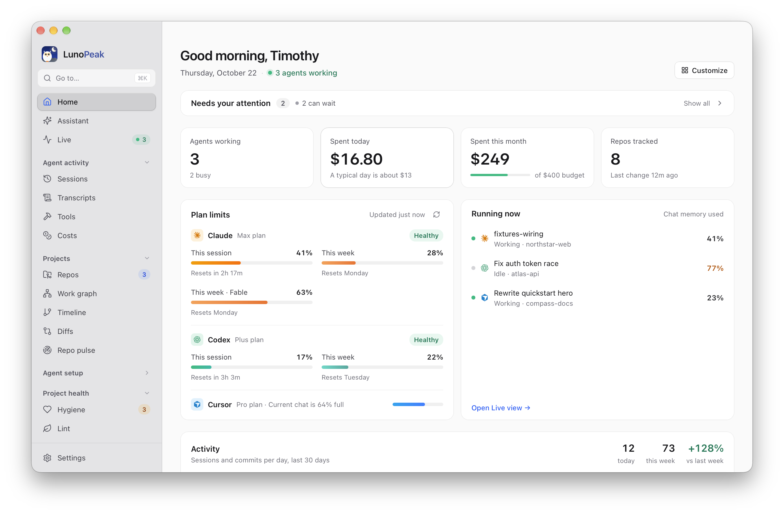
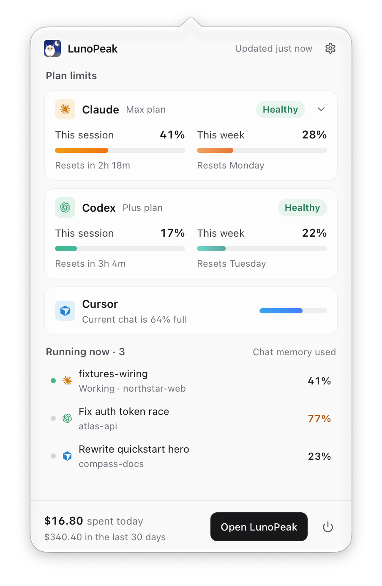
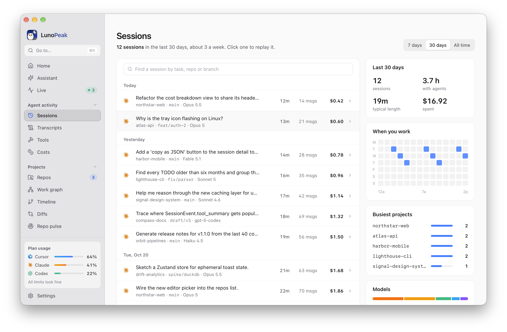
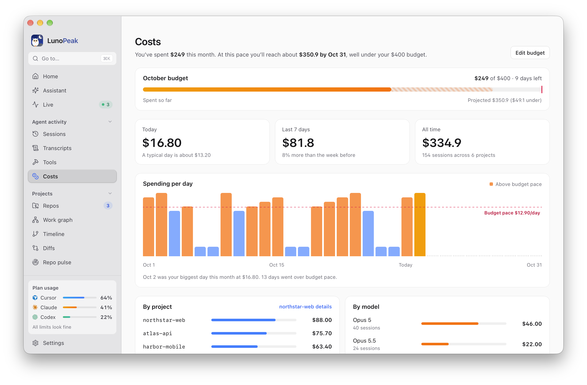
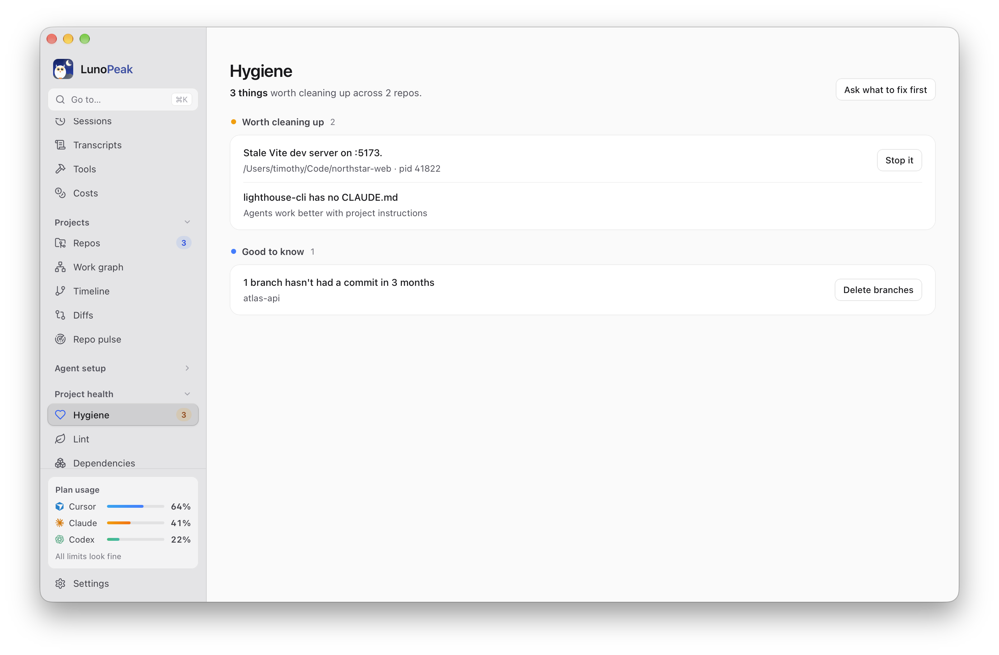

<p align="center">
  
</p>

# LunoPeak


[](LICENSE)
[](https://github.com/sponsors/idevtim)
[](https://buymeacoffee.com/idevtim)

A local-first desktop dashboard for your AI dev environment. One window for every repo, session, agent, and config across **Claude Code, Codex, and Cursor**. No account. No cloud. No telemetry.

LunoPeak is free and open source under the [MIT License](LICENSE).

## Download

[**Download Latest Release**](https://github.com/idevtim/lunopeak/releases/latest)

- **macOS** — Apple Silicon & Intel
- **Windows** — x64 & ARM64
- **Linux** — AppImage (recommended), DEB, or RPM

All builds auto-update except Linux RPM (manual). What changed in each version is in [`release-notes/`](release-notes/).

## Features

### Overview
- **Dashboard** — every active repo, session, and agent at a glance
- **Assistant** — built-in chat with full awareness of your environment, across Anthropic, OpenAI, Gemini, xAI, and local Ollama models
- **Menu bar** — every provider's plan limits on one screen, live sessions with context fill, update badge, and its own settings
- **Terminal** — context fill, plan limits, and cost in your Claude Code status line; built-in items for Codex
- **⌘K** — jump to any page or action from anywhere

### Activity & Sessions
- **Live View** — Claude Code, Codex, and Cursor sessions in real time, each process matched to its own transcript, with per-session context fill
- **Sessions History** — every past session with timing, repo, and outcomes
- **Session Replay** — step through any session turn-by-turn
- **Transcripts** — full-text search across every conversation
- **Tools** — which tools each session used, how often
- **Costs** — token spend per session, repo, and provider with budget alerts

### Code Intelligence
- **Repos** — every project on your machine with health and AI-usage signals
- **Repo Detail** — CLAUDE.md preview, skills, branches, quick actions (open in Claude / VS Code / terminal, git pull)
- **Work Graph** — relationships between repos, branches, and active work
- **Timeline** — cross-repo commits, sessions, and key events
- **Diffs** — uncommitted and recent diffs across every repo
- **Repo Pulse** — activity heatmaps and rolling-window summaries

### Configuration
- **Setup checklist** — Claude Code, Codex, and Cursor inventory: MCP servers, plugins, per-repo completeness
- **Skills** — every Claude skill, global + repo, with previews
- **Subagents** — every agent definition with model, tools, and body
- **Memory** — every CLAUDE.md with topics and line counts
- **Hooks** — every configured hook, scoped per repo

### Health & Hygiene
- **Hygiene** — one-click fixes for stale branches, missing CLAUDE.md, ungitignored `.env`, uncommitted changes, and more
- **Lint** — eslint, prettier, ruff, stylelint, editorconfig across every repo
- **Dependencies** — manifests and audits across npm, yarn, pnpm, composer, cargo, pip, poetry, go, bundler
- **Environment** — `.env` files with key inventory, gitignore status, `.env.example` presence
- **Ports** — bound ports, owning process, working directory

### Backups
- **Snapshots** — local rollback points for project state
- **Worktrees** — manage Git worktrees from one panel

### Privacy & Security
- **Fully Local** — no account, no cloud sync, no telemetry
- **OS Keychain** — Anthropic, OpenAI, Gemini, and xAI keys stored in macOS Keychain / Windows Credential Manager / Linux Secret Service
- **Native Performance** — Tauri 2 (Rust). ~150 MB on disk, ~120 MB resident
- **Outbound Only When You Ask** — plan limits from Anthropic and ChatGPT, public status pages, the optional update check, and provider APIs during Assistant use. Nothing goes to a LunoPeak server; there isn't one. Read the source and check.

## Screenshots

### Home


### Menu bar


### Sessions


### Costs


### Hygiene


## System Requirements

| Platform | Minimum Version |
|----------|----------------|
| macOS | 10.15+ (Apple Silicon & Intel) |
| Windows | 10+ (x64 & ARM64) |
| Linux | Ubuntu 20.04+ / RHEL 8+ (x86_64) |

## Building from source

**Requirements:** Rust (stable), Node 20+, and the [Tauri platform prerequisites](https://tauri.app/start/prerequisites/).

```bash
git clone https://github.com/idevtim/lunopeak.git
cd lunopeak
npm install
npm run tauri:dev     # full app; the first Rust compile takes a few minutes
```

`npm run dev` runs the frontend alone in a browser tab, without the Rust backend — the fastest loop for UI work. `npm run demo` does the same with sample data filled in.

| Command | What it does |
|---|---|
| `npm run typecheck` | TypeScript check |
| `npm run build` | Typecheck + Vite production build |
| `cd src-tauri && cargo test` | Rust tests |
| `npm run tauri:build` | Unsigned platform bundles in `src-tauri/target/release/bundle/` |

Signed, notarized, auto-updating releases use the maintainer's certificates and keys; [`RELEASE.md`](RELEASE.md) documents that pipeline if you want to run your own.

**Stack:** Tauri 2 (Rust) · React 19 · TypeScript · Vite · Tailwind CSS 4 · TanStack Query · Zustand · Recharts.

[`docs/ARCHITECTURE.md`](docs/ARCHITECTURE.md) walks through each subsystem, and [`CLAUDE.md`](CLAUDE.md) is the short map of conventions and gotchas — worth reading whether or not you code with an agent.

## Contributing

Bug reports, ideas, and pull requests are welcome. Start with [CONTRIBUTING.md](CONTRIBUTING.md). Security issues go through [SECURITY.md](SECURITY.md), not public issues.

## Support the Project

LunoPeak is free and will stay free. If it earns its place on your dock:

- ❤️ [**GitHub Sponsors**](https://github.com/sponsors/idevtim) — monthly support
- ☕ [**Buy Me a Coffee**](https://buymeacoffee.com/idevtim) — one-shot tip

## Links

- **Bugs** — [GitHub Issues](https://github.com/idevtim/lunopeak/issues)
- **Ideas** — [GitHub Discussions](https://github.com/idevtim/lunopeak/discussions)
- **Email** — support@idevtim.com
- **Web** — https://lunopeak.com

## License

[MIT](LICENSE) © 2026 Timothy Murphy

Claude, Codex, Cursor, and the other product names and logos shown in LunoPeak belong to their respective owners. LunoPeak is an independent project and is not affiliated with or endorsed by them.
